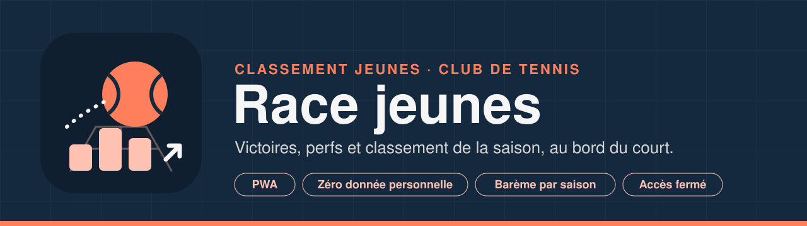
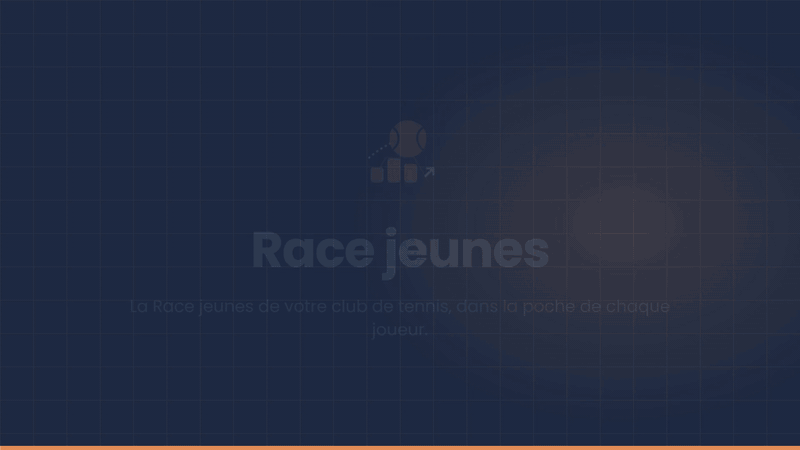
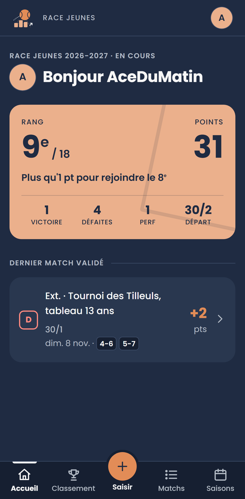
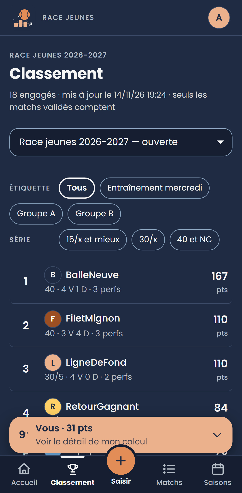
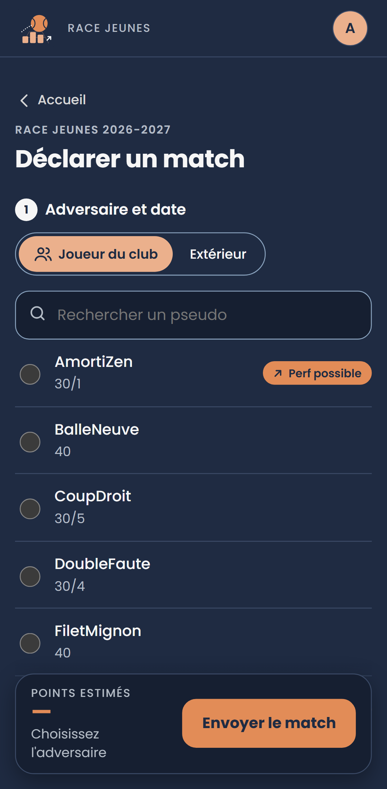
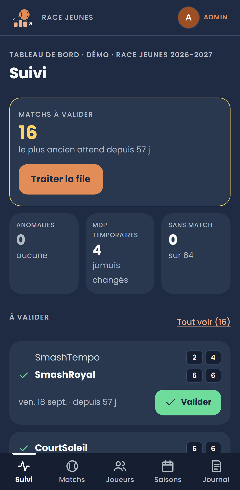

<p align="center">
  
</p>

<p align="center">
  <a href="https://github.com/kinola2605/race-jeunes/actions/workflows/ci.yml"></a>
  <a href="CHANGELOG.md"></a>
  
  
  
</p>

# Race jeunes

Application web installable sur téléphone (PWA) pour suivre la **Race jeunes** d'un club de tennis : chaque
joueur engagé cumule des points selon ses victoires et ses défaites, d'après un **barème propre à chaque
saison**, que le club règle lui-même sans toucher au code.

**[Documentation](docs/README.md)** · [Guide de l'admin](docs/guide-admin.md) ·
[Guide du joueur](docs/guide-joueur.md) · [Le barème expliqué](docs/bareme.md) ·
[Journal des versions](CHANGELOG.md)

<p align="center">
  <a href="docs/assets/video/presentation.mp4">
    
  </a>
  <br>
  <sub>Présentation en 48 secondes · <a href="docs/assets/video/presentation.mp4">vidéo en haute définition (MP4)</a></sub>
</p>

<p align="center">
  
  
  
  
</p>

## Ce qui la distingue

- **Aucune donnée personnelle.** Un joueur n'est qu'un **pseudo** : ni nom, ni e-mail, ni date de naissance,
  ni photo. Aucun cookie de suivi, aucune ressource externe.
- **Accès fermé.** Aucune inscription libre : seul l'admin crée les comptes. Mot de passe temporaire affiché
  une seule fois, à changer à la première connexion.
- **Un barème par saison, sans recalcul silencieux.** Versionné, avec simulateur ; un changement ne s'applique
  aux matchs passés qu'après un aperçu d'impact et un recalcul explicite, tracé au journal.
- **Marque blanche.** Nom, logo et couleurs du club se règlent depuis l'interface.
- **Gratuite à héberger.** Vercel + Neon en offres gratuites, données en Union européenne ; ou Docker.

## Fonctionnalités

| Pour le joueur | Pour l'admin |
|---|---|
| Accueil : rang, points, bilan, écart avec le joueur de devant | Comptes : création unitaire ou import CSV, réinitialisation, désactivation, étiquettes |
| Déclaration d'un match en trois étapes, points estimés en direct | Saisons : brouillon, ouverte, clôturée, archivée ; plusieurs saisons ouvertes possibles |
| Classement filtrable, « Ma position » toujours visible | Éditeur de barème : table par écart, cas particuliers, simulateur, impact, recalcul |
| Détail du calcul de chaque match | Bonus d'assiduité et bonus tournoi |
| Objectif de matchs : « L'échange », un court où la balle avance | File de validation : valider, refuser avec motif, annuler ; doublons signalés |
| Saisons passées | Suivi : matchs à valider, anomalies, mots de passe jamais changés, engagés sans match |
| Avatar composé d'un pictogramme et d'une couleur | Profil mental calculé à partir des scores (tie-breaks, sets décisifs, retours, perfs) |
| « Mes données » : consulter et télécharger (RGPD) | Exports CSV, journal d'audit |
| Thèmes sombre et clair, installable sur le téléphone | Apparence : logo et couleurs du club, contraste vérifié |

## Essayer en 5 minutes

Prérequis : Docker avec Compose.

```bash
git clone https://github.com/kinola2605/race-jeunes.git
cd race-jeunes
docker compose up --build
```

Ouvrez <http://localhost:3000>. Les données de démonstration sont chargées automatiquement (deux saisons aux
barèmes différents, 20 pseudos, environ 120 matchs).

| Compte de démonstration | Pseudo | Mot de passe |
|---|---|---|
| Admin | `admin.demo` | `demo-admin-2026` |
| Joueur | `AceDuMatin` | `demo-joueur-2026` |

> ⚠️ Ces identifiants sont publics : **ne jamais activer la démo en production** (`SEED_DEMO=false`).

## Documentation

| Vous êtes… | Lisez |
|---|---|
| Admin du club | [Guide de l'admin](docs/guide-admin.md) · [Le barème expliqué](docs/bareme.md) |
| Joueur ou parent | [Guide du joueur](docs/guide-joueur.md) |
| Hébergeur | [Vercel + Neon (gratuit)](docs/DEPLOIEMENT.md) · [Docker](docs/installation-docker.md) · [Configuration](docs/configuration.md) |
| Développeur | [Architecture](docs/architecture.md) · [Données personnelles et sécurité](docs/donnees-et-securite.md) · [Contribuer](CONTRIBUTING.md) |

Sommaire complet : [docs/README.md](docs/README.md).

## Technique

Next.js 15 (App Router), React 19, TypeScript strict, PostgreSQL, Prisma 6, argon2id, CSS natif généré depuis
des tokens de design. Le moteur de points est une bibliothèque pure, couverte à 100 %.

```bash
npm install
cp .env.example .env
npm run local-db        # autre terminal : PostgreSQL embarqué, sans Docker
npx prisma migrate deploy && npm run db:seed && npm run dev
```

Avant une PR :

```bash
npm run lint && npm run typecheck && npm run test:coverage && npm run docs:check && npm run build && npm run test:e2e
```

Le projet suit le **Spec-Driven Development** : chaque évolution part d'une
[spécification](specs/README.md) et respecte la [constitution](.specify/memory/constitution.md). Identité
visuelle : [charte et contrastes](design/identite.md), [maquettes](design/maquettes/index.html).

## Licence

Tous droits réservés (voir [LICENSE](LICENSE)). Police Poppins : SIL Open Font License 1.1
(`public/fonts/OFL.txt`). Le logo du projet ([`docs/assets/logo.svg`](docs/assets/logo.svg)) est une création
originale ; chaque club le remplace par le sien.
