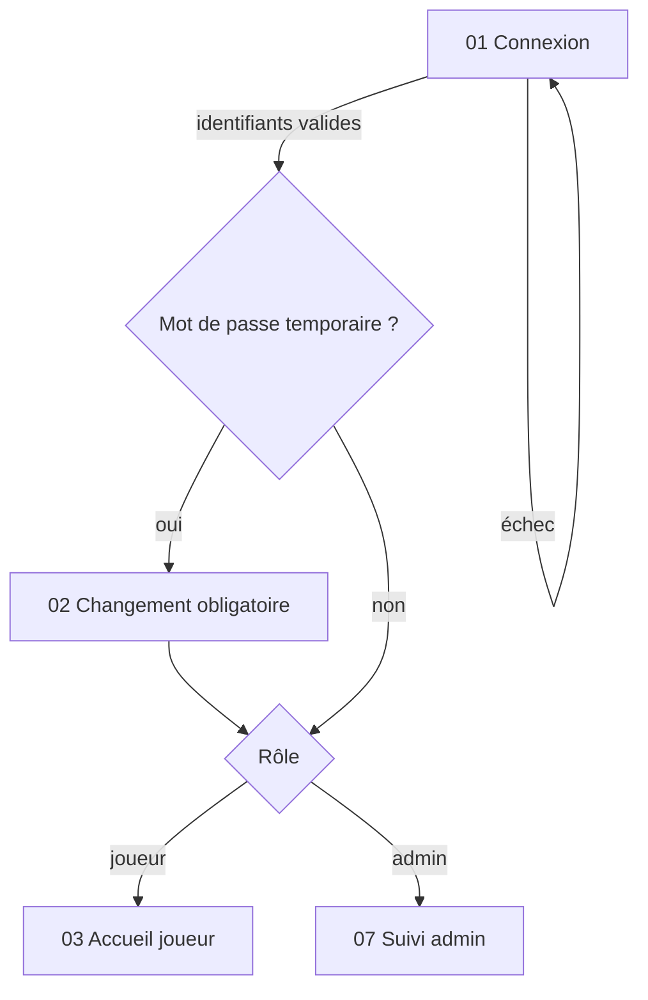
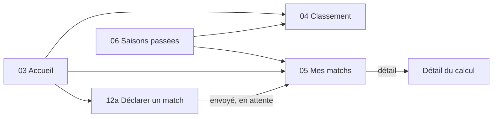
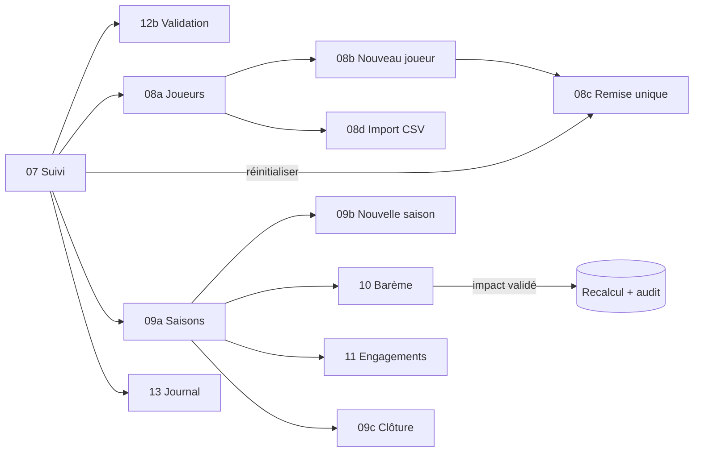

# Parcours et navigation — Race jeunes

> Phase 0. Les identifiants d'écran (`01`, `08c`…) correspondent aux fichiers de `maquettes/`.
> Les références FR-xxx seront ajoutées en phase 2.

## 1. Principe d'accès

- **Une seule route publique** : la connexion (`01`). Pas d'inscription, pas de lien d'invitation, pas de « mot de passe oublié » automatisé (la réinitialisation passe par l'admin).
- Toute autre page exige une session. Sans session → redirection vers `01`.
- Session avec **mot de passe temporaire** → redirection forcée vers `02` tant que le mot de passe n'est pas changé (aucune autre page accessible).
- Le contrôle de rôle est fait **côté serveur** ; la navigation affichée n'est qu'un reflet.

## 2. Joueur

Navigation principale (5 entrées) : barre d'onglets en bas sur mobile, barre latérale à partir de 1024 px (direction B retenue).

| Entrée | Écran | Contenu | Accès depuis |
|---|---|---|---|
| Accueil | `03` | rang, points, V/D, perfs, dernier match, match en attente | connexion, logo |
| Classement | `04` | classement de la saison, sélecteur de saison, filtres (classement, étiquette), détail du calcul | nav, `03`, `06` |
| Matchs | `05` | mes matchs de la saison, statut, détail du calcul d'un match | nav, `03` (dernier match) |
| Saisir | `12a` | déclarer un match (si la saisie joueur est retenue — à clarifier) | nav, `03` (B), état vide `05` |
| Saisons | `06` | saisons passées en lecture seule → `04` / `05` de la saison | nav, `05` |
| Mon compte (pastille pseudo) | `02` (mode volontaire) | changer son mot de passe ; pseudo et classement **non modifiables** | en-tête |

Ce que le joueur **ne voit pas** : comptes, saisons brouillon, barèmes (sauf le nom/version appliqué dans le détail du calcul), journal d'audit, file de validation, matchs des autres joueurs (à clarifier).

## 3. Admin

Navigation principale (5 entrées) : barre d'onglets en bas sur mobile, barre latérale à partir de 1024 px (direction B retenue). Les écrans admin sont conçus pour fonctionner sur mobile et s'élargissent à partir de 1024 px.

| Entrée | Écrans | Actions |
|---|---|---|
| Suivi | `07` | indicateurs (à valider, anomalies, mots de passe temporaires, engagés sans match), raccourcis, exports CSV |
| Matchs | `12b`, `12a` | file de validation (valider, refuser avec motif, corriger, fusionner un doublon, validation groupée), saisie d'un match pour un joueur |
| Joueurs | `08a` → `08b` → `08c`, `08d` | liste, création unitaire, **remise unique** du mot de passe (copie, fiche imprimable), import CSV + compte rendu + fiche téléchargeable une fois, réinitialisation, désactivation/réactivation |
| Saisons | `09a` → `09b`, `09c`, `10`, `11` | liste, création (identifiant + titre, duplication du barème), ouverture, clôture confirmée par saisie de l'identifiant, archivage, **éditeur de barème** (table, paramètres, simulateur, impact puis recalcul explicite), engagements individuels et en lot |
| Journal | `13` | journal d'audit filtrable, export CSV |

L'admin peut aussi consulter les écrans joueur (classement `04`) pour vérifier l'affichage.

## 4. Matrice « qui voit quoi »

| Écran | Joueur | Saisisseur *(à clarifier)* | Admin |
|---|---|---|---|
| 01 Connexion | ✓ | ✓ | ✓ |
| 02 Changement de mot de passe | ✓ | ✓ | ✓ |
| 03 Accueil joueur | ✓ (le sien) | — | — |
| 04 Classement | ✓ (selon visibilité de la saison) | ✓ | ✓ |
| 05 Mes matchs | ✓ (les siens) | — | ✓ (tous) |
| 06 Saisons passées | ✓ | — | ✓ |
| 07 Suivi | — | — | ✓ |
| 08a-d Joueurs | — | — | ✓ |
| 09a-c Saisons | — | — | ✓ |
| 10 Barème | — | — | ✓ |
| 11 Engagements | — | — | ✓ |
| 12a Saisie d'un match | ✓ (pour soi, à clarifier) | ✓ (pour tout engagé) | ✓ |
| 12b Validation | — | — | ✓ |
| 13 Journal | — | — | ✓ |
| 14 États | ✓ | ✓ | ✓ |

## 5. Questions ouvertes révélées par les maquettes

À reprendre en phase 3 (clarification) :

1. Le joueur peut-il déclarer ses matchs (`12a`) ou seulement l'admin / un saisisseur ?
2. Le joueur voit-il le détail des matchs des autres (lien « Détail » dans `04`) ?
3. Visibilité du classement : les trois options de `09b` sont-elles toutes utiles ?
4. Correction après clôture : réouverture exceptionnelle tracée, ou interdiction totale ?
5. Saisie hors ligne au bord du court : file d'attente locale ou simple message d'erreur ?
6. Forfait (WO) et abandon : valeur par défaut des points (`10`, onglet Paramètres).
7. Usage officiel du logo du club dans l'application et sur la fiche imprimable.
