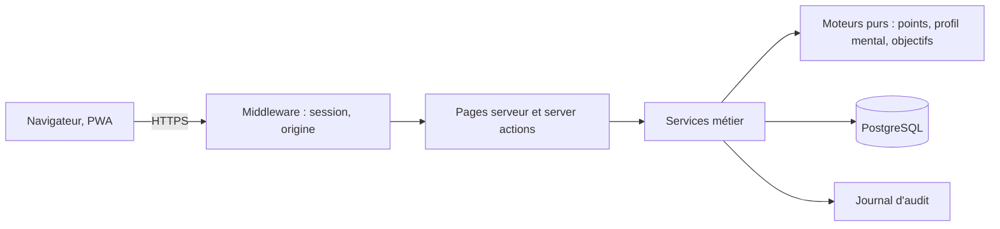
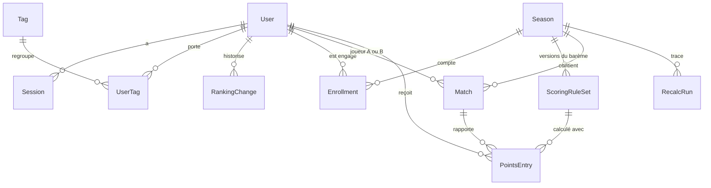
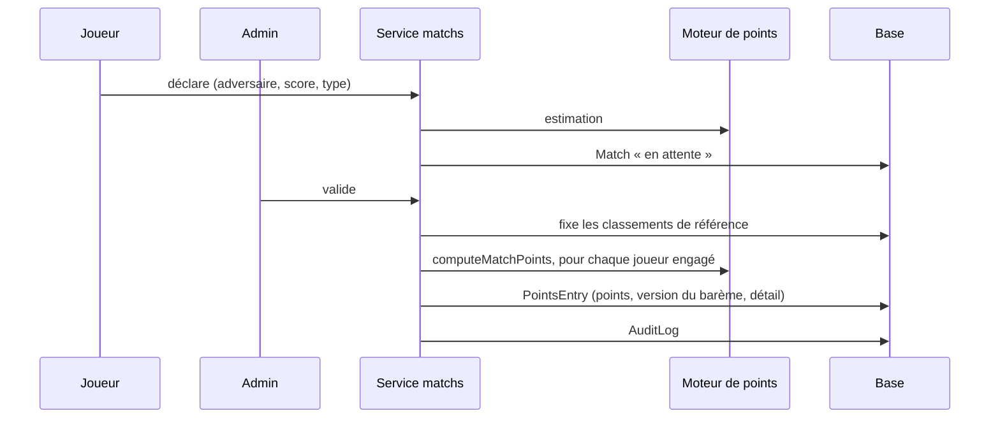

# Architecture

Une application **Next.js 15** (App Router, React 19) adossée à **PostgreSQL** via **Prisma 6**. Un seul
processus, une seule base : pas de micro-service, pas de file de messages, pas de cache distribué
(constitution, principe IX).



## 1. Organisation du code

```
src/scoring/        moteur de points PUR (aucune dépendance base ni framework), couvert à 100 %
src/mental/         profil mental : calcul pur à partir des scores
src/goals/          objectif de matchs : paliers et progression
src/avatar/         avatars (pictogrammes, couleurs), sans fichier
src/appearance/     logo et couleurs du club, contrôle de contraste WCAG
src/privacy/        export des données d'un compte (RGPD)
src/handover/       message de remise du mot de passe (lien mailto)
src/server/auth/    mots de passe (argon2id), sessions, anti-abus
src/server/services/ services métier : comptes, saisons, barèmes, matchs, classement, audit
src/app/            pages Next.js et server actions ; /connexion est la seule page publique
src/components/     composants d'interface
src/styles/         tokens générés + styles de la direction « Court »
prisma/             schéma, migrations, données de démonstration
design/             charte, tokens, maquettes validées, revues UX
specs/, .specify/   spécifications et constitution
tests/e2e/          parcours Playwright
```

**Règle de dépendance** : les dossiers « purs » (`scoring`, `mental`, `goals`, `avatar`, `appearance`,
`privacy`, `handover`) ne connaissent ni la base ni Next.js. Ils prennent des données, rendent un résultat et
se testent sans rien démarrer. Les services lisent la base, appellent ces fonctions et écrivent le résultat.

## 2. Routes

| Zone | Routes | Accès |
|---|---|---|
| Publique | `/connexion`, `/hors-ligne`, manifeste, service worker, `/club-logo`, `/api/health` | tous |
| Mot de passe | `/mot-de-passe` | session ; seule page accessible avec un mot de passe temporaire |
| Joueur | `/accueil`, `/classement`, `/matchs`, `/matchs/nouveau`, `/saisons`, `/compte` | session |
| Admin | `/admin` (suivi), `/admin/matchs`, `/admin/joueurs`, `/admin/saisons/…`, `/admin/journal`, `/admin/apparence` | rôle Admin |
| Fichiers | `/api/export/{classement,matchs,journal}` (CSV, admin), `/api/mes-donnees` (JSON, soi-même ou admin) | session |

Le middleware (`src/middleware.ts`) redirige toute visite sans session vers `/connexion` et refuse les
écritures venant d'une autre origine. Le rôle est **revérifié côté serveur** dans chaque page et chaque
action : la navigation affichée n'est qu'un reflet.

Les écritures passent par des **server actions** (`src/app/actions/`), validées avec Zod. Il n'y a pas d'API
publique.

## 3. Modèle de données



| Table | Rôle |
|---|---|
| `User` | Compte : pseudo, rôle, statut, classement, avatar, empreinte du mot de passe. Aucune donnée personnelle |
| `Session` | Sessions serveur révocables (empreinte HMAC du jeton) |
| `LoginThrottle` | Compteurs anti-abus, purgés après 24 h |
| `Tag`, `UserTag` | Étiquettes libres |
| `RankingChange` | Historique des changements de classement |
| `Season` | Saison : identifiant, titre, statut, mode de classement, visibilité |
| `ScoringRuleSet` | Une version de barème (brouillon ou publiée), règles en JSON, numérotée par saison |
| `Enrollment` | Engagement d'un joueur dans une saison : classement de départ, objectif de matchs |
| `Match` | Match déclaré : joueur A, joueur B ou adversaire extérieur, score, type, tournoi, statut, classements figés à la validation |
| `PointsEntry` | Points d'un joueur pour un match, avec la version de barème et le détail du calcul |
| `RecalcRun` | Trace d'un recalcul, avec son résumé avant/après |
| `AuditLog` | Journal d'audit, en ajout seul |
| `ClubAppearance` | Logo et couleurs du club |

Le classement n'est **pas stocké** : il est recalculé à l'affichage en agrégeant les `PointsEntry` des matchs
validés (`aggregate` puis `rankStandings`). Le profil mental non plus.

## 4. Parcours d'un match



Un changement de barème ne touche les `PointsEntry` existants que par un **recalcul explicite**
(`RecalcRun`), jamais en silence (constitution, principe V). Règles de calcul : [Le barème expliqué](bareme.md).

## 5. Interface

- Direction visuelle « Court » : barre d'onglets en bas sur mobile, barre latérale à partir de 1024 px.
- **CSS natif** généré depuis `design/tokens.json` (`npm run tokens`), sans framework CSS. Toute nouvelle
  couleur passe par les tokens et par une vérification de contraste (`design/identite.md`).
- Police Poppins et icônes auto-hébergées ; aucune ressource tierce.
- PWA : manifeste généré à partir de la configuration du club, service worker qui ne met en cache ni les pages
  ni l'API.

## 6. Tests

| Niveau | Outil | Portée |
|---|---|---|
| Unitaires | Vitest (`src/**/*.test.ts`) | Moteur de points (**100 %** exigé : lignes, branches, fonctions), profil mental, objectifs, avatars, apparence, export RGPD, origine, secrets |
| Bout en bout | Playwright (`tests/e2e/`, profil mobile) | Accès fermé, parcours complet, objectifs, tournoi, avatar, RGPD, envoi par e-mail, profil mental, en-têtes de déploiement |
| CI | GitHub Actions | Lint, typage, tokens à jour, documentation, unitaires, build, E2E, `docker compose up` |

```bash
npm run lint && npm run typecheck && npm run test:coverage && npm run build && npm run test:e2e
```

En local, si le port 3000 est occupé : `E2E_PORT=3100`.

## 7. Développer en local

Prérequis : Node.js 22. PostgreSQL 16 ou plus, ou la base embarquée fournie.

```bash
npm install
```

```bash
cp .env.example .env
```

```bash
# autre terminal : PostgreSQL embarqué sur le port 54329
npm run local-db
```

```bash
npx prisma migrate deploy && npm run db:seed && npm run dev
```

Comptes de démonstration : [Installation avec Docker § 1](installation-docker.md#1-démonstration-en-5-minutes).
Toutes les commandes : [Configuration § 3](configuration.md#3-commandes).

## Captures d'écran

Les captures de la documentation (`docs/assets/captures/`) sont générées par Playwright à partir des données
de démonstration, jamais à partir de données réelles.

```bash
# application démarrée en local sur une base de démonstration
npm run docs:captures
```

Par défaut le script vise `http://localhost:3000` ; `DOCS_BASE_URL` permet d'en changer. À relancer quand un
écran illustré change.

## 8. Déploiement

Deux cibles, même code : [Vercel + Neon](DEPLOIEMENT.md) (production actuelle, région Francfort) et
[Docker](installation-docker.md). Les migrations sont additives et appliquées **avant** le déploiement du code
qui les utilise ; sur Vercel elles ne sont jamais lancées automatiquement.
