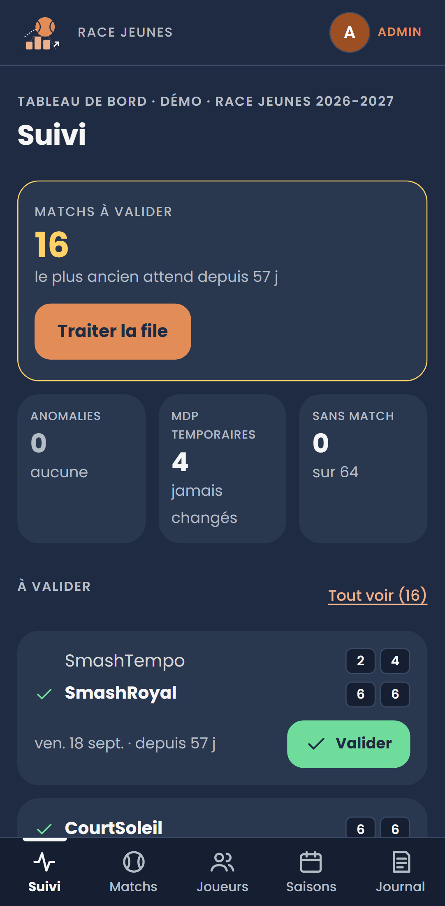
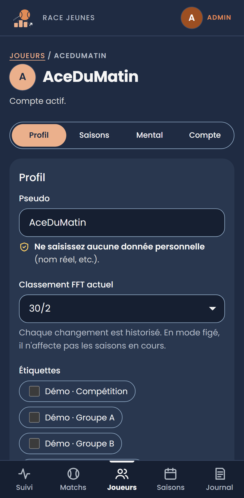
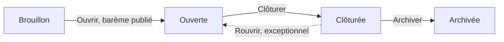
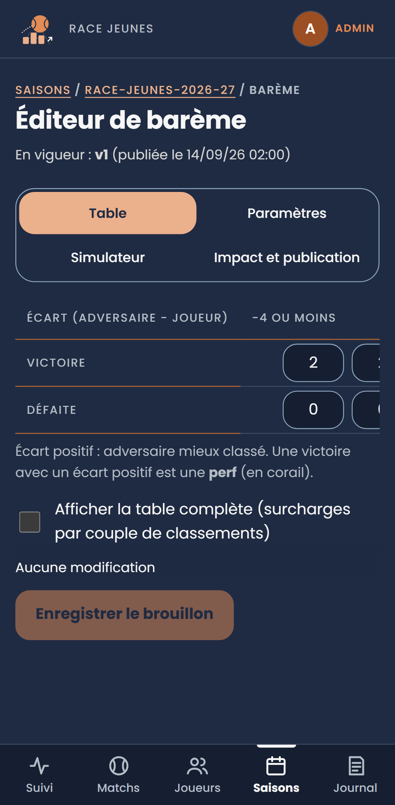
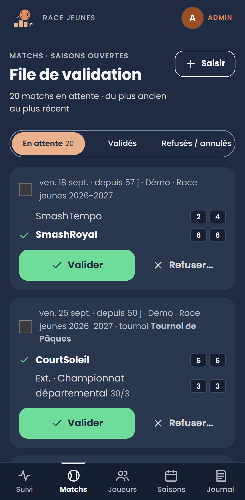

# Guide de l'admin

Pour l'enseignant ou le bénévole qui gère la Race. Tout se fait depuis un téléphone ou un ordinateur, avec un
compte **Admin**.

**Sommaire** : [Premiers pas](#1-premiers-pas) · [Joueurs](#2-joueurs) · [Saisons](#3-saisons) ·
[Barème](#4-barème) · [Engagements](#5-engagements) · [Matchs](#6-matchs) · [Suivi](#7-suivi) ·
[Exports et journal](#8-exports-et-journal) · [Apparence](#9-apparence-du-club) ·
[Profil mental](#10-profil-mental) · [Données personnelles](#11-données-personnelles) ·
[Questions fréquentes](#12-questions-fréquentes)

<p align="center"></p>

## 1. Premiers pas

La navigation de l'admin compte cinq entrées : **Suivi**, **Matchs**, **Joueurs**, **Saisons**, **Journal**.
« Mon compte » (votre pseudo, en haut de l'écran ou en bas de la barre latérale) donne accès au mot de passe,
au thème, à l'avatar et à la page **Apparence**.

Pour lancer une Race, dans l'ordre :

| Étape | Où | Détail |
|---|---|---|
| 1. Créer la saison | Saisons → Nouvelle saison | [§3](#3-saisons) |
| 2. Régler et publier le barème | Saison → Barème | [§4](#4-barème) |
| 3. Créer les comptes des joueurs | Joueurs → Nouveau joueur ou Importer | [§2](#2-joueurs) |
| 4. Engager les joueurs dans la saison | Saison → Engagements | [§5](#5-engagements) |
| 5. Ouvrir la saison | Saison → Ouvrir | [§3](#3-saisons) |
| 6. Valider les matchs au fil de l'eau | Matchs | [§6](#6-matchs) |

> **Règle d'or** : l'application n'enregistre **aucune donnée personnelle**. Un joueur est un pseudo. Ne
> saisissez jamais de nom réel, ni dans un pseudo, ni dans un libellé d'adversaire, ni dans un motif de refus.

## 2. Joueurs

### Créer un compte

**Joueurs → Nouveau joueur.** Vous renseignez :

- un **pseudo** unique (3 à 20 caractères : lettres, chiffres, `_ . - &`) ; « PetitPont » et « petitpont » sont
  le même pseudo ;
- son **classement** FFT ;
- des **étiquettes** facultatives (« Groupe A », « Mardi 17 h »…) pour filtrer et engager en lot ;
- en option, son engagement immédiat dans une saison ouverte.

L'application génère un **mot de passe temporaire**, affiché **une seule fois**. Sur cet écran de remise, vous
pouvez le copier, imprimer une fiche à donner au joueur, ou cliquer sur **Envoyer par e-mail** : votre
messagerie s'ouvre avec un message prêt, vous saisissez vous-même le destinataire. L'application ne connaît et
ne conserve aucune adresse e-mail.

À sa première connexion, le joueur doit choisir son propre mot de passe.

### Importer plusieurs comptes

**Joueurs → Importer.** Le fichier CSV contient deux colonnes, et seulement deux :

```csv
pseudo;classement
AceDuMatin;30/2
SliceMaster;30/1
```

Le séparateur est `;` ou `,`. Un fichier qui contient une autre colonne (un nom, par exemple) est **refusé en
entier**. Pour les pseudos déjà existants, vous choisissez : les ignorer, ou mettre à jour leur classement. Le
compte rendu liste les comptes créés, ignorés et les erreurs ligne par ligne. Les mots de passe temporaires
des comptes créés s'affichent une seule fois : imprimez les fiches à ce moment-là.

### Gérer un compte

La liste se recherche par pseudo et se filtre par **statut** (actif, désactivé, mot de passe temporaire) et
par **étiquette**. La fiche d'un joueur a quatre onglets :

<p align="center"></p>

| Onglet | Ce qu'on y fait |
|---|---|
| **Profil** | Modifier le pseudo, le classement et les étiquettes. Chaque changement de classement est daté dans « Historique du classement » |
| **Saisons** | Voir ses engagements et fixer son **objectif de matchs** pour chaque saison : de 1 à 200, vide = pas d'objectif. Le joueur voit alors sa progression sur son accueil. L'objectif n'a aucun effet sur les points |
| **Mental** | Lire son profil mental ([§10](#10-profil-mental)) |
| **Compte** | **Réinitialiser le mot de passe** quand il l'a oublié (nouveau mot de passe temporaire, sessions coupées), télécharger ses données, **désactiver le compte** |

Désactiver un compte déconnecte le joueur immédiatement et l'empêche de se reconnecter. Un compte n'est jamais
supprimé, pour que les classements passés restent exacts. Il peut être réactivé.

## 3. Saisons

Une saison est une édition de la Race. Elle a un **identifiant** stable (par exemple `race-jeunes-2026-27`), un
titre libre, et son propre barème.

### Créer

**Saisons → Nouvelle saison.** Trois réglages comptent :

| Réglage | Choix | Conseil |
|---|---|---|
| **Barème** | Copier celui d'une autre saison, ou partir d'un barème vide | Copiez celui de l'an dernier : la copie est indépendante |
| **Classement de référence des engagés** | *Figé* à l'engagement, ou *évolutif* (classement à la date du match) | Figé : tout le monde garde le même repère toute la saison |
| **Visibilité du classement** | Tous les joueurs connectés, engagés seulement, ou chacun ne voit que son rang | Selon l'âge et l'esprit du groupe |

La saison est créée en **brouillon** : seuls les admins la voient.

### Cycle de vie



- **Ouvrir** : possible dès que le barème a une version publiée. Les joueurs engagés peuvent déclarer des
  matchs. Plusieurs saisons peuvent être ouvertes en même temps.
- **Clôturer** : vous confirmez en saisissant l'identifiant de la saison. Le classement devient le classement
  final, la saison passe en lecture seule et les matchs encore en attente sont annulés. Traitez donc la file de
  validation **avant** de clôturer.
- **Rouvrir** : pour corriger une erreur après clôture. L'action est tracée au journal.
- **Archiver** : la saison reste consultable, pour l'historique.

Une fois la saison ouverte, son identifiant ne change plus ; le titre reste modifiable.

## 4. Barème

**Saison → Barème.** L'éditeur a quatre onglets. Le détail de chaque règle et des exemples chiffrés sont dans
[Le barème expliqué](bareme.md).

| Onglet | Ce qu'on y fait |
|---|---|
| **Table** | Points de victoire et de défaite selon l'écart de classement ; cas particuliers par couple de classements |
| **Paramètres** | Non-classés, victoire par forfait, plafond par match, bonus d'assiduité, bonus tournoi |
| **Simulateur** | Tester un match fictif et voir les points, avec la version publiée et avec le brouillon |
| **Impact et publication** | Voir ce que le brouillon changerait, publier, lancer un recalcul |

<p align="center"></p>

Vous travaillez toujours sur un **brouillon**. Les erreurs bloquantes s'affichent en direct ; les simples
avertissements (par exemple une victoire à +2 qui rapporte moins qu'à +1) ne bloquent pas.

**Publier** crée une nouvelle version numérotée. Elle s'applique aux matchs validés **à partir de ce moment**.
Les matchs déjà validés gardent leurs points : il n'y a **jamais de recalcul silencieux**. Si vous voulez
appliquer la nouvelle version aux matchs passés, l'onglet « Impact et publication » vous montre d'abord le
nombre de matchs et de joueurs touchés et les changements de rang ; vous lancez ensuite le **recalcul**
vous-même. Il est enregistré au journal avec un résumé avant/après.

Le barème d'une saison clôturée est verrouillé.

## 5. Engagements

**Saison → Engagements.** Un joueur doit être **engagé** dans une saison pour y figurer et y déclarer des
matchs.

- Cochez des joueurs un par un, ou utilisez la **sélection rapide par étiquette** pour engager tout un groupe.
- Le **classement de départ** est par défaut le classement actuel du joueur. Il reste modifiable tant que le
  joueur n'a aucun match validé.
- Un engagé sans aucun match dans la saison peut être retiré.

## 6. Matchs

Les joueurs déclarent leurs matchs ; **vous seul les validez**. Un match ne rapporte des points qu'une fois
validé.

### File de validation

**Matchs** affiche les matchs en attente sous forme de cartes « tableau de score » : les deux joueurs, le
vainqueur coché, le score, le tournoi éventuel. Pour chacun :

| Action | Effet |
|---|---|
| **Valider** | Les points sont calculés avec la version publiée du barème et le classement est mis à jour. Si l'adversaire est aussi un engagé, il reçoit ses points de son côté |
| **Refuser** | Avec un motif, que le joueur verra. Aucun point |
| **Annuler** | Pour un match déjà validé d'une saison ouverte : ses points sont retirés |

Cochez plusieurs matchs pour les valider d'un coup. Un **doublon probable** (même paire de joueurs, même date)
est signalé : vérifiez avant de valider. Trois onglets en haut de l'écran : **En attente**, **Validés**,
**Refusés / annulés**.

<p align="center"></p>

### Saisir un match vous-même

**Matchs → Saisir un match** : pour n'importe quel engagé, avec validation immédiate si vous le souhaitez.
Pratique en bord de court ou après un tournoi.

Le formulaire est le même que celui du joueur : adversaire **du club** (un autre engagé) ou **extérieur**
(un libellé neutre comme « Adversaire TC Voisin » et son classement, jamais de nom), date, résultat, type
(normal, forfait, abandon), score, et la case **« Match joué en tournoi »** avec le nom du tournoi.

## 7. Suivi

**Suivi** est votre tableau de bord. Il répond à quatre questions :

| Indicateur | Que faire |
|---|---|
| **Matchs à valider** | Ouvrir la file de validation |
| **Anomalies** : doublons probables, adversaires extérieurs non classés | Vérifier, corriger ou refuser |
| **Mots de passe temporaires jamais changés** | Le joueur ne s'est pas encore connecté : le relancer, ou réinitialiser s'il a perdu sa fiche |
| **Engagés sans match validé** | Les encourager à jouer |

## 8. Exports et journal

Depuis le détail d'une saison, deux **exports CSV** : le **classement** (rang, pseudo, classement de départ,
étiquettes, matchs, victoires, défaites, perfs, bonus d'assiduité, bonus tournoi, points) et les **matchs**
(date, joueurs, classements, vainqueur, score, type, statut, points de chacun). Ils s'ouvrent dans un tableur.

**Journal** enregistre toutes les actions d'administration : comptes, saisons, barèmes, engagements, matchs,
recalculs, apparence, téléchargements de données, verrouillages de connexion. Il se filtre par type, ne peut
pas être modifié et s'exporte aussi en CSV. Il est conservé 5 ans.

## 9. Apparence du club

**Mon compte → Apparence.**

- **Nom du club** et **sigle** : saisis lors de l'installation, modifiables ici. Le nom apparaît sur la page de
  connexion, les fiches imprimables et l'application installée ; le sigle en haut de chaque page.
- **Logo** : déposez celui du club (PNG, JPEG, WebP ou SVG, 512 Ko au plus). Il est utilisé dans les deux
  thèmes, sur la page de connexion, sur les fiches imprimables et comme icône de l'application installée.
- **Couleurs** : quatre couleurs (accent et action, en thème sombre et en thème clair), avec aperçu en direct.
  Une couleur trop peu lisible sur son fond est **refusée**, pour que l'application reste lisible par tous.

Un clic suffit pour revenir au logo ou aux couleurs par défaut. Les changements s'appliquent tout de suite,
sans intervention technique.

## 10. Profil mental

Sur la **fiche d'un joueur**, l'onglet **Mental** donne cinq indicateurs, calculés à partir des scores
déjà enregistrés. Rien n'est à saisir.

| Indicateur | Ce qu'il mesure |
|---|---|
| Tie-breaks | Gagnés / joués |
| Sets décisifs | Troisièmes sets (ou super tie-breaks) gagnés / joués |
| Retours | Victoires après avoir perdu le premier set |
| Face à un mieux classé | Perfs / matchs joués contre mieux classé |
| Face à un moins bien classé | Contre-perfs / matchs joués contre moins bien classé. **Ici, un pourcentage bas est le bon signe** |

Chaque indicateur affiche le pourcentage, les nombres (« 2 gagnés sur 3 joués ») et la valeur du **groupe**
(tous les engagés de la saison). Une situation jamais rencontrée affiche « — », pas 0 %. Avec plusieurs
saisons, un tableau compare le joueur d'une saison à l'autre.

Les forfaits ne comptent jamais. Sur peu de matchs, un pourcentage ne veut pas dire grand-chose : regardez
toujours les nombres. Le profil mental est **réservé à l'admin** ; les joueurs ne le voient pas.

## 11. Données personnelles

L'application enregistre un pseudo, un classement, des étiquettes, des matchs et des points. Rien d'autre.

- Chaque joueur peut consulter et télécharger ses données depuis **Mon compte → Mes données**.
- Vous pouvez le faire pour lui depuis sa fiche, onglet **Compte** : **Télécharger ses données (RGPD)**, y compris pour un compte
  désactivé. Chaque téléchargement est tracé au journal.
- Une demande de rectification ou d'effacement vous est adressée : vous corrigez le pseudo ou le classement
  depuis la fiche, ou vous désactivez le compte.

Détail : [Données personnelles et sécurité](donnees-et-securite.md).

## 12. Questions fréquentes

**Un joueur a oublié son mot de passe.** Fiche du joueur → onglet Compte → réinitialiser. Il n'existe pas de « mot de passe
oublié » automatique, puisque l'application ne connaît aucune adresse e-mail.

**Un joueur est bloqué à la connexion.** Après 5 échecs en 15 minutes sur un même pseudo, la connexion est
bloquée 15 minutes, même avec le bon mot de passe. Attendez, ou réinitialisez son mot de passe.

**J'ai validé un match par erreur.** Dans Matchs, onglet « Validés » : annulez-le. Ses points sont retirés.

**Un joueur a changé de classement en cours de saison.** Modifiez-le sur sa fiche. En mode *figé*, cela ne
change rien aux matchs de la saison. En mode *évolutif*, le nouveau classement s'applique aux matchs joués
après la date du changement.

**Je me suis trompé dans le barème après avoir validé des matchs.** Corrigez le brouillon, publiez, regardez
l'impact, puis lancez le recalcul ([§4](#4-barème)).

**Il faut corriger un match d'une saison clôturée.** Rouvrez la saison, corrigez, clôturez à nouveau.

**Un joueur ne voit pas le classement.** Vérifiez qu'il est engagé dans la saison et le réglage « Visibilité
du classement » de la saison.
