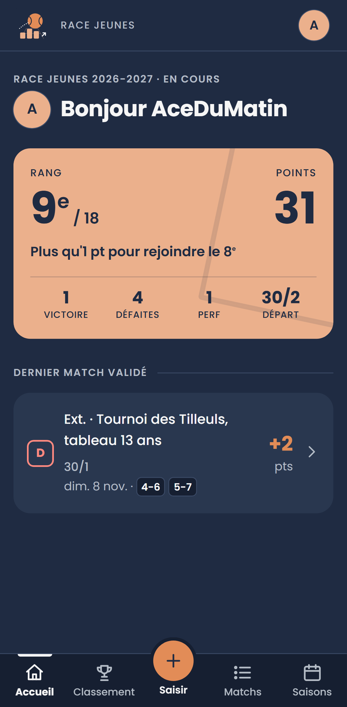
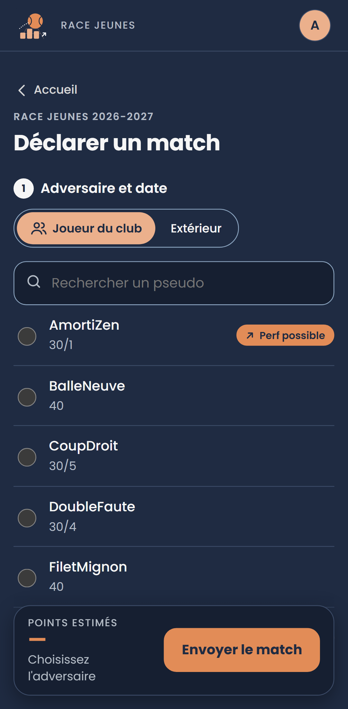
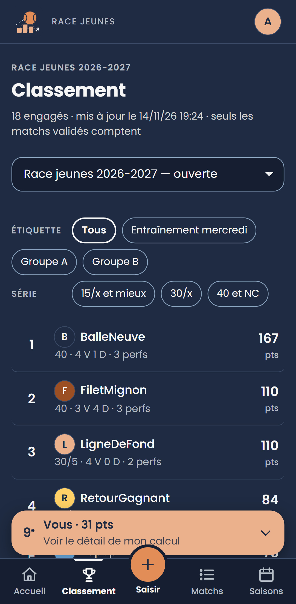

# Guide du joueur

Pour les joueuses, les joueurs et leurs parents. L'application sert à suivre la **Race** du club : tu joues
des matchs, tu gagnes des points, tu montes au classement.

**Sommaire** : [Se connecter](#1-se-connecter) · [Installer l'appli](#2-installer-lappli-sur-le-téléphone) ·
[Accueil](#3-laccueil) · [Déclarer un match](#4-déclarer-un-match) · [Classement](#5-le-classement) ·
[Mes matchs et mes points](#6-mes-matchs-et-mes-points) · [Mon compte](#7-mon-compte) ·
[Questions](#8-questions-fréquentes)

## 1. Se connecter

Le club te remet un **pseudo** et un **mot de passe temporaire**. Personne ne peut s'inscrire seul : c'est le
club qui crée les comptes.

1. Ouvre l'adresse de l'application donnée par le club.
2. Saisis ton pseudo et le mot de passe temporaire.
3. L'application te demande aussitôt de **choisir ton propre mot de passe** : au moins 10 caractères, et il ne
   doit pas contenir ton pseudo. Une petite phrase facile à retenir fait très bien l'affaire.

Tu as oublié ton mot de passe ? Demande au club : il t'en remet un nouveau.

> Ton pseudo est ton seul nom dans l'application. Elle ne connaît ni ton vrai nom, ni ton âge, ni ton adresse
> e-mail, et n'utilise aucune photo.

## 2. Installer l'appli sur le téléphone

L'application s'installe comme une appli normale, sans passer par un magasin d'applications.

- **iPhone** (Safari) : bouton Partager, puis « Sur l'écran d'accueil ».
- **Android** (Chrome) : menu ⋮, puis « Installer l'application » ou « Ajouter à l'écran d'accueil ».

Il faut une connexion à Internet pour l'utiliser.

## 3. L'accueil

En bas de l'écran, cinq boutons : **Accueil**, **Classement**, **Saisir**, **Matchs**, **Saisons**.

L'accueil te montre :

- **Ma position** : ton rang, tes points, tes victoires, tes défaites, tes perfs, et combien de points il te
  manque pour rejoindre le joueur juste devant toi ;
- tes matchs **en attente** de validation par le club ;
- ton **dernier match** validé ;
- si le club t'a fixé un **objectif de matchs** : « L'échange », un petit court où la balle avance à chaque
  match joué. L'objectif ne donne pas de points : il t'encourage à jouer.

## 4. Déclarer un match

Appuie sur **Saisir**, au centre de la barre. Trois étapes :

1. **L'adversaire.** S'il est du club et participe à la Race, choisis son pseudo. Sinon choisis
   « extérieur » : écris un libellé simple (par exemple « Joueur du TC voisin », **jamais son vrai nom**) et son
   classement.
2. **Le match.** La date, si tu as gagné ou perdu, et le type : normal, **forfait** (le match n'a pas été
   joué) ou **abandon** (le match s'est arrêté avant la fin). Si c'était en tournoi, coche **« Match joué en
   tournoi »** et écris le nom du tournoi.
3. **Le score**, set par set (par exemple 6/4 6/3). Pas de score pour un forfait.

En bas, l'application affiche les **points estimés**. Envoie : ton match est **en attente**. Il comptera quand
le club l'aura validé.

Si ton adversaire est aussi dans la Race, un seul de vous deux déclare le match : il comptera pour les deux.

## 5. Le classement

Le classement range les joueurs par **points**. À égalité de points, celui qui a le plus de **perfs** passe
devant, puis celui qui a le plus de victoires. Si tout est égal, vous partagez le même rang.

Une **perf**, c'est une victoire contre un joueur mieux classé que toi.

Ta ligne « Ma position » reste toujours visible. Tu peux filtrer par groupe (étiquette) ou par série de
classement. Selon le choix du club, tu vois tout le classement ou seulement ton rang.

## 6. Mes matchs et mes points

**Matchs** liste tous tes matchs de la saison, mois par mois :

| Statut | Ce que ça veut dire |
|---|---|
| En attente | Le club ne l'a pas encore validé |
| Validé | Il compte ; les points sont affichés |
| Refusé | Le club l'a refusé, avec une explication. Corrige et déclare-le à nouveau si besoin |
| Annulé | Il ne compte pas |

Ouvre un match validé pour voir **comment tes points ont été calculés** : ton classement, celui de ton
adversaire, l'écart, la règle du barème appliquée. Pour tout comprendre : [Le barème expliqué](bareme.md).

**Saisons** garde tes saisons passées, avec ton rang final et tes points.

## 7. Mon compte

Touche ton pseudo, en haut de l'écran.

- **Avatar** : compose le tien avec un pictogramme (balle, raquette, trophée…) et une couleur. Sans choix,
  c'est l'initiale de ton pseudo.
- **Thème** : sombre ou clair. Le clair se lit mieux en plein soleil.
- **Mot de passe** : tu peux le changer quand tu veux.
- **Mes données** : la liste de ce que l'application enregistre sur toi, et un bouton **« Télécharger mes
  données »** pour tout récupérer dans un fichier.
- **Se déconnecter**, en bas de la page.

Ton pseudo et ton classement sont gérés par le club : demande-lui s'il y a une erreur.

## 8. Questions fréquentes

**Mon match n'apparaît pas dans mes points.** Il est sûrement encore « en attente ». Seuls les matchs validés
comptent.

**Je me suis trompé en déclarant un match.** Préviens le club : il peut le refuser, et tu le déclares à
nouveau.

**L'application dit que mon compte est bloqué.** Après 5 mots de passe faux, il faut attendre 15 minutes.
Ensuite, si tu ne te souviens plus de ton mot de passe, demande au club.

**Je ne peux pas déclarer de match.** Il faut que le club t'ait engagé dans la saison et que la saison soit
ouverte.

**J'ai perdu : est-ce que je perds des points ?** Non. Une défaite rapporte zéro ou quelques points selon le
barème, jamais des points en moins.

**Je veux changer de pseudo ou faire supprimer mes données.** Adresse-toi au club.
