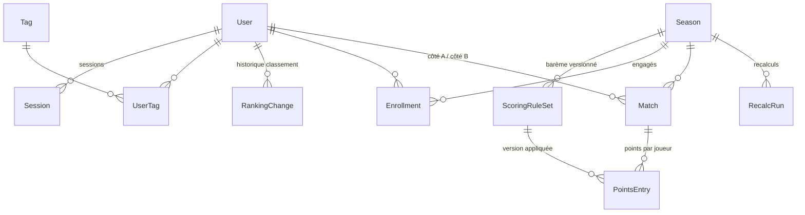

# Modèle de données — Race jeunes

Source exécutable : [`prisma/schema.prisma`](../../prisma/schema.prisma). Aucun champ ne contient de donnée
personnelle (constitution III).



| Entité | Rôle | Champs clés | Règles |
|---|---|---|---|
| **User** | joueur ou admin (le « Player » du brief : un compte = un joueur) | `pseudo`, `pseudoKey` (minuscules, unique), `passwordHash` (argon2id), `role` PLAYER/ADMIN, `status` ACTIVE/DISABLED, `mustChangePassword`, `ranking` | jamais supprimé s'il a un historique ; FR-020 à FR-025 |
| **Session** | session serveur | `id` = SHA-256 du jeton du cookie, `expiresAt` | révoquée à la désactivation, au changement et à la réinitialisation du mot de passe |
| **LoginThrottle** | anti-abus | `key` = `pseudo:`/`ip:` + SHA-256, `failures`, `lockedUntil` | 5 échecs / pseudo, 20 / IP, 15 min ; purge 24 h |
| **Tag / UserTag** | étiquettes libres | `name` | aucune catégorie d'âge ou de sexe |
| **RankingChange** (« RankingHistory ») | historique des classements | `from`, `to`, `effectiveAt`, `changedById` | sert au mode évolutif (FR-106) |
| **Season** | édition de la Race | `slug` (unique, stable), `title`, dates facultatives, `status` DRAFT/OPEN/CLOSED/ARCHIVED, `rankingMode` FROZEN/EVOLVING, `visibility` ALL/ENROLLED/SELF | lecture seule si CLOSED/ARCHIVED |
| **ScoringRuleSet** | barème d'une saison | `seasonId`, `version`, `status` DRAFT/PUBLISHED, `rules` (JSON, schéma `RuleSet`), `copiedFromId` | unique (`seasonId`, `version`) ; au plus un brouillon |
| **Enrollment** | engagement | `seasonId`, `userId`, `startingRanking` | unique (`seasonId`, `userId`) |
| **Match** | match déclaré ou saisi | `playedOn`, `playerAId`, `playerBId` **ou** `externalLabel` + `externalRanking`, `winner` A/B, `score` (point de vue de A), `kind` NORMAL/WALKOVER/RETIREMENT, `status` PENDING/VALIDATED/REFUSED/CANCELLED, `refusalReason`, `rankingA`/`rankingB` (figés à la validation) | FR-100 à FR-108 |
| **PointsEntry** (« PointsLedgerEntry ») | points d'un joueur pour un match validé | `points`, `gap`, `isPerf`, `won`, `breakdown` (JSON), `ruleSetId` | unique (`matchId`, `userId`) ; remplacée uniquement par un recalcul explicite |
| **RecalcRun** | trace d'un recalcul | `ruleSetId`, `matchCount`, `changedCount`, `summary` | FR-066 |
| **AuditLog** | journal d'audit | `actorPseudo`, `type`, `action`, `target`, `details` | ajout seul, jamais de mot de passe |

## Le document `RuleSet` (barème)

```jsonc
{
  "unrankedAs": "40",                        // NC traité comme 40, ou "NC" (échelon propre)
  "win":  { "byGap": { "-4": 2, "-3": 2, "-2": 4, "-1": 6, "0": 10, "1": 20, "2": 30, "3": 40, "4": 50 } },
  "loss": { "byGap": { "-4": 0, "-3": 0, "-2": 0, "-1": 0, "0": 1,  "1": 2,  "2": 2,  "3": 2,  "4": 2  } },
  "overrides": { "win": { "30/2|30/1": 25 }, "loss": {} },   // table complète facultative
  "walkoverWin": 0,                          // victoire par forfait (jamais une perf)
  "capPerMatch": 60,                         // null = aucun plafond
  "assiduity": { "every": 5, "points": 5 }   // null = pas de bonus
}
```

Écart = échelon de l'adversaire − échelon du joueur ; −4 signifie « −4 ou moins », 4 « +4 ou plus ».

## Transitions d'état

- Saison : `DRAFT → OPEN` (barème publié requis) `→ CLOSED` (saisie de l'identifiant ; matchs en attente
  annulés ; brouillon de barème supprimé) `→ ARCHIVED`. `CLOSED → OPEN` : réouverture exceptionnelle tracée.
- Match : `PENDING → VALIDATED | REFUSED | CANCELLED` ; `VALIDATED → CANCELLED` (points retirés).
- Barème : `DRAFT → PUBLISHED` ; une version publiée n'est jamais modifiée.
